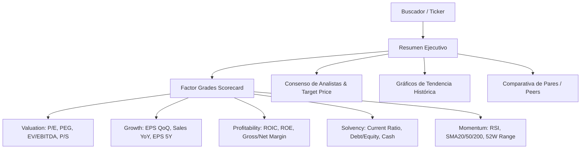
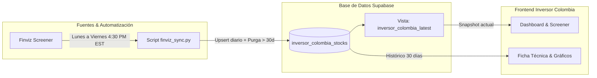

# Plan Maestro: Aplicativo Web "Inversor Colombia"
*(Inspirado en Seeking Alpha Pro + Finviz Data Engine)*

---

## 1. Visión del Producto y Propuesta de Valor

**"Inversor Colombia"** es una plataforma web de inteligencia bursátil para inversores en acciones de Estados Unidos y mercados globales. Combina la riqueza de **más de 100 métricas financieras** (extraídas automáticamente sin costo de API desde Finviz) con el modelo analítico y visual de **Seeking Alpha**:
- **Factor Grades (A+ a F):** Calificación cuantitativa en Valoración, Crecimiento, Rentabilidad, Solvencia y Momento Técnico.
- **Histórico Móvil de 30 Días:** Gráficos de evolución mensual de precios, RSI, volumen y múltiplos para cada acción.
- **Screener & Peers:** Comparación instantánea contra competidores directos de la misma industria.
- **Cero Costo de Operación:** Backend en Supabase (PostgreSQL) y frontend desplegable en Vercel/Netlify.

---

## 2. Hallazgos del Análisis de Seeking Alpha

Seeking Alpha es la plataforma de referencia para inversores individuales e institucionales debido a su estructura de información:

### Funciones Clave a Replicar en Inversor Colombia:
1. **Factor Grades Scorecard:** Un cuadro de notas escolares (A+, A, B, C, D, F) que traduce 20 números complejos en una señal intuitiva para el inversor.
2. **Triangulación de Valoración:** Comparar el precio actual contra el **Target Price** promedio de analistas y su rango de 52 semanas.
3. **Análisis de Rentabilidad:** Poner foco en **ROIC** (Retorno sobre Capital Invertido) y Márgenes Netos.
4. **Matriz de Pares (Peers Matrix):** Al ver `PSX`, mostrar automáticamente `VLO`, `MPC`, `XOM` con sus ratios lado a lado.
5. **Evolución 30 Días:** Mostrar si la acción viene ganando o perdiendo momento en el último mes.

---

## 3. Arquitectura del Sistema

---

## 4. Módulos del Aplicativo Web

### Módulo 1: Tablero Principal (Market Dashboard)
- **Barra de Estado del Mercado:** Hora de cierre de Wall Street y fecha del último snapshot.
- **KPI Cards Rápidas:**
  - *Top Value:* Acciones con menor PEG y P/E positivo.
  - *Líderes de Rentabilidad:* Mayor ROIC y Margen Neto.
  - *Oportunidades Técnicas:* Acciones con RSI en zona de rebote (RSI entre 40 y 55) y SMA200 alcista.
- **Gráfico Comparativo de Sectores:** Rendimiento semanal y mensual por sector económico.

### Módulo 2: Screener Cuantitativo Avanzado
- Tabla de alta densidad con paginación, ordenación por cualquier columna y búsqueda rápida en vivo.
- Filtros preconfigurados:
  - *Filtro "Graham & Dodd" (Valor Clásico):* PEG < 1, P/E < 20, Debt/Eq < 1.
  - *Filtro "Calidad y Crecimiento":* ROIC > 15%, Margen > 10%, EPS QoQ > 20%.
  - *Filtro "Dividendo Seguro":* Dividend Yield > 3%, Payout sostenible, Current Ratio > 1.2.
- Exportación directa a CSV o JSON desde el navegador.

### Módulo 3: Ficha Técnica de la Acción (Stock Deep Dive al estilo Seeking Alpha)
- **Cabecera:** Ticker, Empresa, Sector, Industria, Precio, Variación % y Capitalización.
- **Factor Grades Scorecard:**
  - *Valoración:* Nota calculada a partir de P/E, Forward P/E, PEG, EV/EBITDA y P/S.
  - *Crecimiento:* Nota basada en EPS QoQ, Sales YoY TTM y EPS Past 5Y.
  - *Rentabilidad:* Nota basada en ROIC, ROE, Margen Operativo y Margen Neto.
  - *Solvencia Financiera:* Nota basada en Current Ratio, Debt/Equity y Cash per share.
  - *Momento Técnico:* Nota basada en RSI, distancia a SMA200 y rendimiento en 1 mes.
- **Gráfico de Línea Temporal (30 Días):** Curva interactiva de Precio, RSI y Volumen en los últimos 30 días utilizando nuestra base de datos.
- **Resumen y Noticias:** Titulares recientes y resumen ejecutivo (*Daily Digest*).

### Módulo 4: Comparador de Pares (Peers Comparison)
- Permite seleccionar 2 a 5 acciones y contrastar sus métricas frente a frente (ej: Apple vs Microsoft vs Nvidia).

### Módulo 5: Watchlist / Cartera de Seguimiento
- Guardado local de acciones de interés del usuario sin obligar a registrarse, con cálculo del rendimiento promedio.

---

## 5. Diseño y Estética Visual (Design System)

Siguiendo las mejores prácticas de plataformas financieras institucionales:
- **Tema:** Dark Mode moderno (*Onyx & Slate*) con acentos en verde esmeralda (`#10b981`) para alzas y carmín (`#ef4444`) para bajas.
- **Tipografía:** *Inter* o *Plus Jakarta Sans* para lectura limpia de datos numéricos.
- **Tablas:** Tipografía monoespaciada en cifras numéricas para alineación decimal perfecta.
- **Badges de Calificación:** Cajas con colores temáticos para las notas (A = Verde brillante, B = Verde lima, C = Amarillo ámbar, D = Naranja, F = Rojo suave).

---

## 6. Fases de Implementación Propuestas

| Fase | Alcance | Entregables |
| :--- | :--- | :--- |
| **Fase 1: Automatización del Pipeline** | Configurar la ejecución automática lunes a viernes a las 4:30 PM EST. | Script `.bat` para Task Scheduler de Windows o flujo GitHub Actions gratuito. |
| **Fase 2: Fundamentos del Frontend** | Crear proyecto React + Vite + TypeScript con conexión directa a Supabase. | Estructura base, configuración de Tailwind/CSS variables y cliente Supabase. |
| **Fase 3: Screener y Dashboard** | Construcción del Tablero principal y el Screener de 103 columnas. | Tabla interactiva, ordenación multi-columna, filtros de sector y buscador. |
| **Fase 4: Ficha de Acción & Factor Grades** | Algoritmo de cálculo de calificaciones A-F y vista individual de la acción. | Factor Grades Scorecard, panel de fundamentales y visualización de ratios. |
| **Fase 5: Gráficos de 30 Días y Pares** | Visualización gráfica de la ventana móvil de 30 días y comparador de pares. | Gráficos Recharts / Lightweight Charts interactivos. |
| **Fase 6: Pulido y Despliegue** | Pruebas de rendimiento, optimización móvil y puesta en producción. | Build de producción y guía de despliegue en Vercel o local. |
